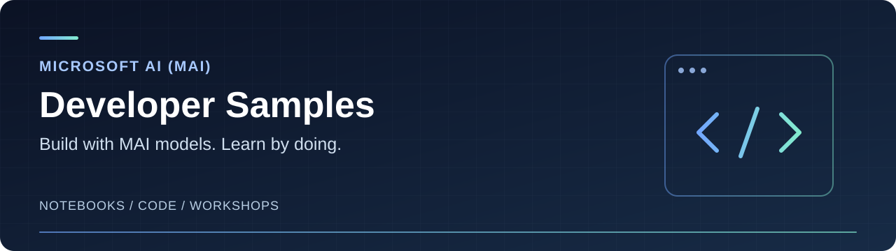

  

# Microsoft AI (MAI) Developer Samples

Code samples and reusable assets to help you build with **Microsoft AI (MAI) models**.

Explore practical developer scenarios through runnable code, notebooks, and hands-on workshops. Each sample calls a MAI model deployment to demonstrate model capabilities, with step-by-step setup instructions you can follow, learn from, and adapt for your own projects.

> **Getting started:** We're preparing the first samples. Notebooks, workshops, and other learning resources will be added here as they become available.

## What you'll find

| Resource | What to expect | Status |
| --- | --- | --- |
| Notebook samples | Guided, interactive examples for exploring MAI models and practical use cases. | Coming soon |
| Code samples | Runnable examples that demonstrate how to integrate MAI models into applications. | Coming soon |
| Workshops | Hands-on learning paths with setup instructions and guided exercises. | Coming soon |
| Reusable assets | Supporting documentation and resources to help you adapt the samples. | Coming soon |

## Access MAI models

**Use MAI in your coding workflow through GitHub Copilot, or integrate MAI into your application through Microsoft Foundry, Azure Speech, or OpenRouter.**

| Developer goal | Where | How to access |
| --- | --- | --- |
| Code with MAI | [GitHub Copilot](https://docs.github.com/en/copilot/reference/ai-models/supported-models) | Select an available MAI coding model in Copilot's model picker. Availability depends on your plan, Copilot surface, and organization policies. |
| Build an app on Azure | [Microsoft Foundry](https://ai.azure.com/) / [Azure Speech](https://learn.microsoft.com/azure/ai-services/speech-service/mai-voices) | Use your Azure subscription to set up a supported model or service, authenticate, and call its API. Start with the [reasoning](https://learn.microsoft.com/azure/foundry/foundry-models/how-to/use-foundry-models-mai-thinking), [image](https://learn.microsoft.com/azure/foundry/foundry-models/how-to/use-foundry-models-mai-image), or [voice](https://learn.microsoft.com/azure/ai-services/speech-service/mai-voices) guide. |
| Build an app through a unified third-party API | [OpenRouter](https://openrouter.ai/microsoft/) | Create an OpenRouter API key, choose a listed MAI model ID, and follow that model's API guide. |

> Model availability, pricing, and data-handling terms vary by platform. **Copilot access does not provide an API key for your application**, and not every MAI model is available on every platform. Check the linked documentation for current models, regions, preview restrictions, and any additional access requirements.

## Getting started

Once samples are available:

1. **Choose a sample or workshop** that matches what you want to build.
2. **Follow its README** to install prerequisites and dependencies.
3. **Configure model access** using your own credentials and the environment variables documented by that sample.
4. **Run, explore, and adapt** the code for your own project.

Requirements, supported models, endpoint configuration, and environment variable names will be documented per sample. Access to a model deployment is required; any usage charges depend on your endpoint provider and account.

## Model access and credentials

Samples connect to MAI model deployments through publicly available endpoints. You supply your own credentials through environment variables.

- Never put credentials directly in source code or notebooks.
- Never commit secrets, local credential files, or notebook outputs containing sensitive information.
- Use only data you are authorized to send to your configured model endpoint.

This repository contains **sample code and documentation only**. It does not include model weights, customer data, internal source code, or secrets.

## Project status

This repository is under active preparation. The sample catalog and contribution guidance will grow as content is published.

## Maintainers

Maintained by **Microsoft Developer Relations (Cloud Advocacy)** in partnership with the **Microsoft AI (MAI) team**, and hosted in the [Microsoft Foundry GitHub organization](https://github.com/microsoft-foundry).

## Support and community

See [Support](SUPPORT.md) for sample issues and help. Report security vulnerabilities privately using the instructions in [Security](SECURITY.md), not through public issues.

This project has adopted the [Microsoft Open Source Code of Conduct](CODE_OF_CONDUCT.md).

## License

The sample code and documentation in this repository are licensed under the [MIT License](LICENSE). The license does not grant access to MAI models or change the terms of your configured model endpoint.
