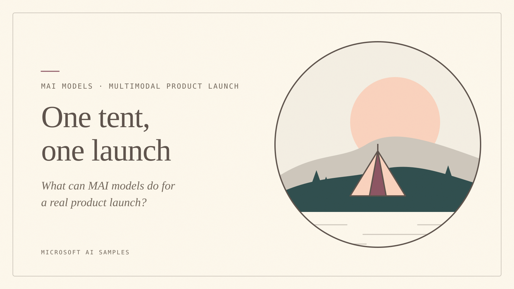

<p align="center">
  
</p>

# Multimodal Product Launch with MAI Models

> **What can Microsoft AI (MAI) models do for a real product launch — and which model fits each job?**

A hands-on workshop for developers. **Contoso Outdoors**, a made-up retailer of camping gear, is relaunching its **TrailMaster X4** tent. You'll build the whole launch kit with MAI models in Microsoft Foundry and GitHub Copilot: posters and ads with **MAI-Image**, a radio spot with **MAI-Voice**, checked transcripts with **MAI-Transcribe**, and a new storefront with a **MAI-Code** model.

Each notebook gives one job to one MAI model family, and answers the questions a customer would ask about it. Where a model comes in a standard and a **Flash** version, we try both and decide which job needs which.

<br/>

## The notebooks

| # | Notebook | The question | Models |
| --- | --- | --- | --- |
| 00 | [Set the stage](./00-set-the-stage.ipynb) | What can MAI models do for a real product launch? | None. The story, the launch kit, and how to use this workshop |
| 01 | [Build the launch kit](./01-build-launch-kit.ipynb) | How can MAI-Image-2.6 models support a real product launch? | MAI-Image-2.6, MAI-Image-2.6-Flash |
| 02 | [Give it a voice](./02-give-it-a-voice.ipynb) | How can MAI-Voice-2.1 models give a launch its voice? | MAI-Voice-2.1, MAI-Voice-2.1-Flash |
| 03 | [Hear your customers](./03-hear-your-customers.ipynb) | How can MAI-Transcribe-2 turn launch audio into answers? | MAI-Transcribe-2 |
| 04 | [Refresh the storefront](./04-refresh-the-storefront.ipynb) | Can a coding model turn our napkin sketch into a website? | The latest MAI-Code-X.Y-Flash in GitHub Copilot (may be in preview) |
| 99 | [Learner guide](./99-learner-guide.ipynb) | How do you build with MAI models, step by step? | All six MAI models: a reference manual with request templates and a debugging playbook. Runs without Azure |

Each one stands alone, but they tell one story in order: the pictures from 01 become the radio ad in 02, the ad is checked in 03, and 04 puts it all on the new launch page. Keep 99 open beside them as your manual.

<br/>

## Read now, run later

Notebooks 01 and 04 come **pre-run**. Open them and read the saved results; you don't need Azure, and nothing costs money. Notebooks 02 and 03 show saved results once a live run has produced them.

Each notebook shows two times:

- **Review time:** how long it takes to read through the saved results.
- **Run time:** how long a fresh live run takes, including rate-limit waits.

<br/>

## Get set up

**In the dev container (recommended).** Open this repository in GitHub Codespaces or a VS Code dev container. It installs Python 3.12, Node.js, the Azure CLI and the Azure Developer CLI, and its post-create step installs this folder's `requirements.txt` into the repo's `.venv`. Pick `.venv` as the notebook kernel, and you're ready to read in replay mode.

**On your own machine.** You need Python 3.11+, and Node.js for notebook 04. From the repo root:

```bash
python3 -m venv .venv
.venv/bin/python -m pip install -r workshops/mai-multimodal-product-launch/requirements.txt
```

<br/>

## Run it live

1. **Sign in.** `az login --use-device-code`
2. **Deploy.** 
   - Ensure you are in the `workshops/mai-multimodal-product-launch` folder
   - Run `bash infra/setup.sh`. It:
      - checks that your region offers the MAI image models, and skips them with a warning if not,
      - creates a resource group with a Microsoft Foundry resource and project,
      - deploys **MAI-Image-2.6** and **MAI-Image-2.6-Flash**, and gives you the **Foundry User** role,
      - writes this folder's `.env` with the endpoint and deployment names.

   Voice and transcription come with the Foundry resource, so there's nothing to deploy for 02 and 03.
3. **Switch to live.** In each notebook's "Before you start" section, set `DEMO_MODE = "live"` in the mode cell. To switch every notebook at once, add `DEMO_MODE=live` to `.env` instead. The mode cell wins over `.env`.
4. **Run the cells in order** with **Shift + Enter**.
5. **Clean up** when you're finished: `bash infra/teardown.sh` deletes the resource group after you confirm its name.

| Setting | Default | Change it with |
| --- | --- | --- |
| Region | `eastus` | `AZURE_LOCATION=<region> bash infra/setup.sh` |
| Resource group | `rg-mai-multimodal-product-launch` | `AZURE_RESOURCE_GROUP=<name> bash infra/setup.sh` |

> 🌎 **Region:** `eastus` offers every MAI model this workshop uses: image, voice and transcription. Other regions may lack some of them. For example, `westus` has no MAI voices, and `westus3` has no MAI image models. See [Speech regions](https://learn.microsoft.com/azure/ai-services/speech-service/regions) and the Foundry model catalog.

Notebook 04 builds a website, so running it live also needs **Node.js** and npm, plus GitHub Copilot in VS Code. The readiness check in notebook 00 tells you what's missing.

Your pictures, audio and site files are saved under `output/`, which Git ignores. Replay mode shows yours first, then ours from `examples/`.

<br/>

## Honest notes

| Note | What it means for you |
| --- | --- |
| **Release status varies** | MAI-Image-2.6 and Flash are generally available in Foundry. MAI-Voice-2.1 and Flash are in preview, and the MAI-Code Flash model in Copilot may be too. Check the model cards before production promises |
| **Every run is different** | Your pictures and audio won't match ours. Judge them with each section's checklist, not by matching ours |
| **Text and speech are English-first** | Have a native speaker check other languages |
| **You pay per use** | Per picture, per character spoken and per hour transcribed. See [MAI pricing](https://aka.ms/MAIModelPricing) and [Speech pricing](https://aka.ms/SpeechPricing) |

<br/>

## What's in this folder

| Path | What it is |
| --- | --- |
| `00-…ipynb` to `04-…ipynb` | The notebooks |
| `requirements.txt` | The Python packages these notebooks need |
| `.env.example` | Every setting the notebooks read. `infra/setup.sh` creates `.env` from it |
| `infra/` | `main.bicep`, `setup.sh` and `teardown.sh`: everything Azure needs for this workshop |
| `assets/` | Banners, section cards, and the napkin sketches |
| `examples/` | Saved results from our runs, used in replay mode |
| `output/` | Your own results from live runs. Git ignores it |

The product catalog (manuals, photos and prices) lives in the shared [Contoso Retail dataset](../../data/contoso-retail/README.md), so other samples can reuse it. Contoso Outdoors is a made-up company; its product data comes from [Azure-Samples/contoso-web](https://github.com/Azure-Samples/contoso-web) (MIT).
